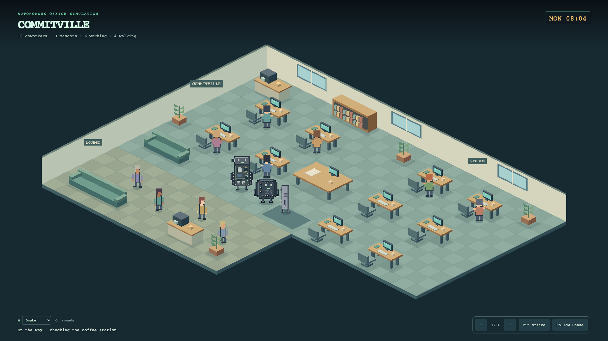

# Commitville

Commitville is an autonomous pixel-art office simulation designed to run continuously on a shared display. It is not a game that waits for a player: its characters follow schedules, satisfy needs, collaborate, get distracted, and react to office events on their own.

The public project contains only fictional sample data and generic artwork. Real people, private company information, and organization-specific configuration do not belong in this repository.

## Status

Commitville is in its foundation phase. The current app proves the browser runtime, rendering loop, simulation clock, automated checks, and deployment pipeline.

Dnake, the intercom mascot, walks autonomously around an angled 2.5D office,
avoiding furniture and pausing at the coffee station, desks, meeting area and
lounge. Four facing directions and stepping frames reflect the route. Zoom,
pan, fit the room or follow Dnake with the camera controls. A narrow screen starts
in follow mode so the character stays readable.

The office also includes C2-260, a broad charcoal controller mascot, and C3 Plus,
a taller exposed-board mascot with a coin cell, relays and side terminals. All
three have their own four-direction animation and patrol, avoid furniture and use
cell reservations to avoid walking through one another. Select a mascot beside
the activity text to inspect its routine or follow it.

When friends meet on the floor, they pause, face one another and exchange speech
bubbles. A nearby third mascot can join in. After the chat they resume their
routes, with a cooldown between encounters.

The earlier flat preview is still available at `?view=flat`, including optional
licensed art. The default angled room uses original code-drawn geometry and needs
no private files.



The office now has a larger L-shaped footprint, ten desks and ten fictional
coworkers alongside the three mascots. Some work at their desks while others
wander through the studio and lounge or take coffee breaks. Their seeded
schedules alternate work and breaks, and the HUD shows the current activity mix.

## Stack

- TypeScript for application and simulation logic
- Phaser for 2D rendering and animation
- Vite for development and production builds
- Vitest for deterministic simulation tests
- ESLint and Prettier for automated code quality
- GitHub Actions and GitHub Pages for continuous delivery
- Chromium kiosk mode for the Raspberry Pi display

## Quick start

Requirements: Node.js 24 and npm 11 or newer.

```bash
npm install
npm run dev
```

Open the URL printed by Vite. The development server listens on the local network so the app can also be tested from a Raspberry Pi or another device.

Licensed local art packs are optional. After placing Pixelwood Valley in the ignored private asset directory, run:

```bash
npm run dev:private
```

See [Assets](docs/ASSETS.md) for the exact directory structure and licensing boundary.

## Commands

```bash
npm run dev          # start the development server
npm run dev:private  # prepare licensed local art and start the server
npm run build        # type-check and create a production build
npm run build:private # prepare licensed local art and build privately
npm run test         # run unit tests once
npm run lint         # run ESLint
npm run format:check # verify formatting
npm run check        # run every CI check locally
```

## Documentation

- [Vision](docs/VISION.md)
- [Architecture](docs/ARCHITECTURE.md)
- [Development workflow](docs/DEVELOPMENT.md)
- [Assets and licensing](docs/ASSETS.md)
- [Privacy boundary](docs/PRIVACY.md)
- [Roadmap](docs/ROADMAP.md)
- [Architecture decisions](docs/decisions/README.md)
- [Contributing](CONTRIBUTING.md)

## Project philosophy

Commitville favors clear ownership over clever abstraction:

- Organize by responsibility first and domain second.
- Extract responsibilities, not lines of code.
- Keep tooling modular, readable, and easy to change.
- Record why decisions were made, not only what the final code does.
- Automate repetitive work while keeping the project understandable.

These principles are adapted from [Luka Jioshvili's development writing](https://dev.to/lazydoomslayer).

## License

No open-source license has been selected yet. The source is publicly visible, but no reuse rights are granted until a license is added.
